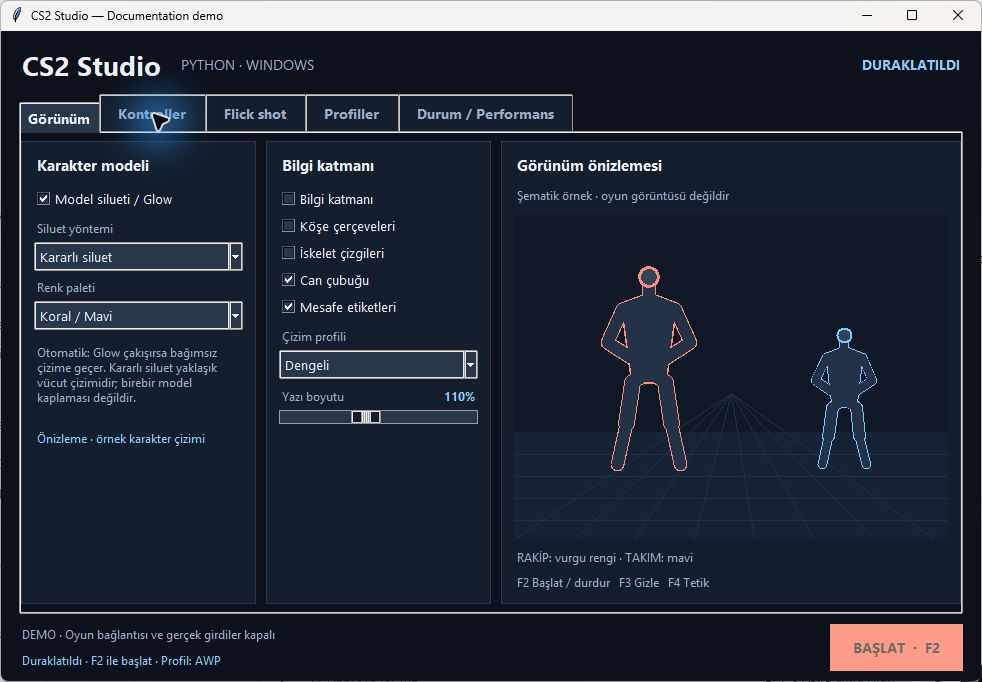
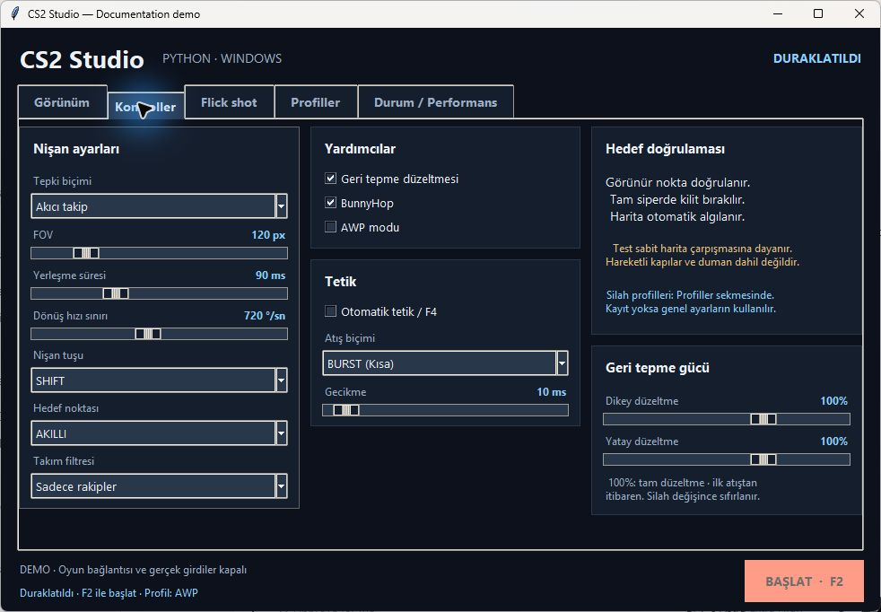
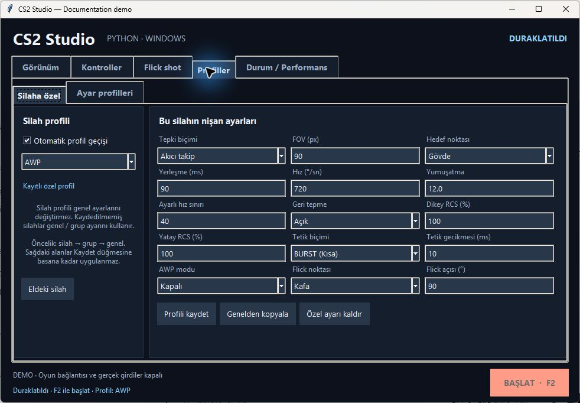
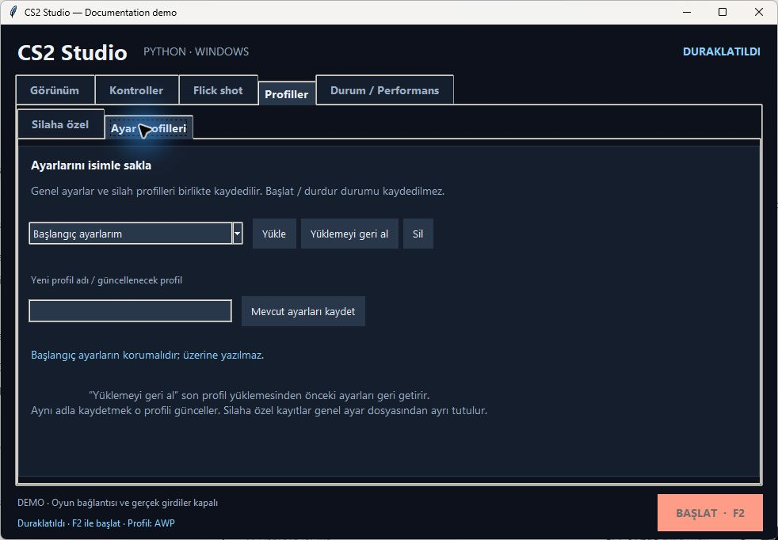
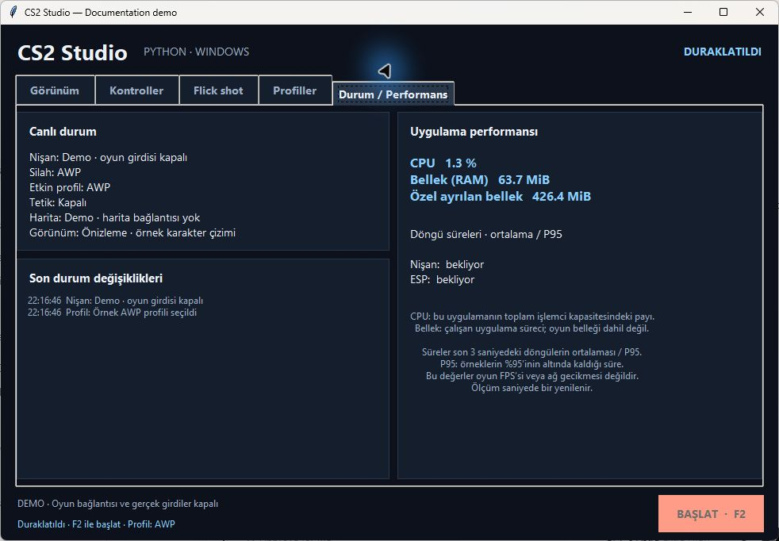

# CS2 Studio — External Cheat Toolkit

**Counter-Strike 2 · Python · Windows x64 · ESP · Aim / RCS · Weapon profiles**

[Türkçe](README.tr.md) · [Installation](docs/INSTALL.md) · [Build from source](docs/BUILD.md) · [User guide](docs/USAGE.md) · [Architecture](docs/ARCHITECTURE.md)

CS2 Studio is an open-source Python external CS2 cheat with a compact Tkinter panel, ESP visualization, aim tracking, recoil control, flick sequencing, per-weapon profiles and local performance diagnostics. It reads and writes game memory and generates input. The interface is currently Turkish; documentation is available in English and Turkish.

> **Account risk:** this project is not VAC-safe or undetectable. Anti-cheat cooldowns and bans are possible. Renaming an executable does not establish safety. Functional tests do not evaluate anti-cheat detection. No zero-miss or one-shot-kill guarantee is made.



Screenshots show the real application UI in **offline demo mode** with synthetic character drawings and example profiles. They are not gameplay captures or evidence of in-game accuracy. The performance panel measures the demo/application process, not CS2 FPS.

## Features

| Area | Included |
| --- | --- |
| ESP / visuals | Game Glow, independent approximate silhouette, optional skeleton, corner boxes, health and labels |
| Aim / recoil | Smooth tracking, target stability, configurable vertical and horizontal recoil gains |
| Flick sequence | Configurable button, single shot sequence, view restoration, knife selection and previous-weapon return |
| Profiles | Gun → weapon group → general precedence; named settings, protected initial snapshot and undo |
| Diagnostics | Current state, active profile, application CPU/RAM and loop mean/P95 timings |
| Offsets | Complete commit-matched snapshots selected against the installed game's build |
| Interface | Five tabs in a 980 × 650 content area; checked at 100%, 125% and 150% scaling |

## Quick start: preview without the game

Use Windows x64 and Python 3.11 x64. From PowerShell:

```powershell
git clone https://github.com/tolgaugurlu/cs2-external-cheat-studio.git
cd cs2-external-cheat-studio
py -3.11 -m venv .venv
.\.venv\Scripts\python.exe -m pip install -r requirements.txt
.\.venv\Scripts\python.exe memory_bot.py --demo
```

Demo mode does not connect to the game, download offsets, write your settings, install GSI or send game input. The main activation button is disabled. You can inspect tabs and try profile controls in memory.

For a complete source setup, follow [Installation](docs/INSTALL.md). To create the EXE and a clean portable ZIP, follow [Build from source](docs/BUILD.md). Do not run the full app and demo as evidence of anti-cheat compatibility.

## Interface

| Controls | Weapon profiles |
| --- | --- |
|  |  |

| Named settings | Status and performance |
| --- | --- |
|  |  |

[Flick panel](docs/images/03-flick.png) · [Full screenshot gallery](docs/SCREENSHOTS.md)

## What the package does and does not include

The repository contains current Python modules, synthetic tests, the C# map converter source, pinned dependency lists, a build specification and documentation. It does not contain personal settings, GSI tokens, logs, game assets, map caches, offset dumps, legacy scripts or a renamed Windows-service installer.

The first normal launch uses the application's defaults. Save a gun profile to enable different values for that weapon; otherwise general values apply. Existing `ayar.json` files can be retained when upgrading. Back up `ayar.json`, `profiller.json` and `gsi_config.json` before replacing an existing installation.

## Limits

- Game updates can invalidate offsets. If neither supported source matches the installed build, activation is blocked rather than using known-old values.
- Visibility uses static map collision. Smoke, moving doors, changed breakable objects and every rendered model pixel are not represented.
- The independent silhouette is an approximation from skeletal points, not the game's exact mesh. Game Glow may flicker when the game rewrites its fields.
- Spread, movement, network delay and weapon deployment remain relevant. Tests cannot establish a zero-miss shot or an in-game performance gain.
- Profile selection and diagnostics are convenience features, not anti-cheat protections.

## Development

```powershell
.\.venv\Scripts\python.exe -m pip install -r requirements-dev.txt
.\.venv\Scripts\python.exe -m unittest discover -s tests -q
.\.venv\Scripts\python.exe tools/check_studio_layout.py
```

The tests use synthetic memory, mock input and application-owned render surfaces. They do not require a running CS2 process or a downloaded offset dump. See [Contributing](CONTRIBUTING.md) for verification expectations.

## Credits and license

Distributed under the existing [MIT license](LICENSE), retaining its original copyright notice. Offset providers: [a2x/cs2-dumper](https://github.com/a2x/cs2-dumper) and [sezzyaep/CS2-OFFSETS](https://github.com/sezzyaep/CS2-OFFSETS). Map conversion uses [ValveResourceFormat](https://github.com/ValveResourceFormat/ValveResourceFormat). Dependency licenses apply separately; see [Third-party notices](THIRD_PARTY_NOTICES.md).

This is an independent project, not affiliated with or endorsed by Valve or Counter-Strike.
