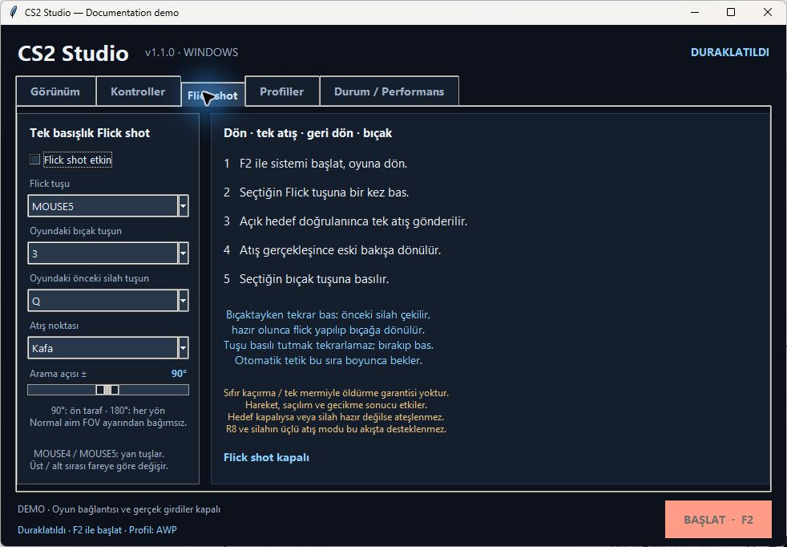

# Screenshot gallery / Ekran görüntüleri

Version 1.1.0: real Tkinter UI captured from `CS2Studio-1.1.0.exe --demo`. Synthetic characters and example profiles; no game connection. Diagnostics describe the demo process, not gameplay. Version 1.1.2 uses the name **Studio Panel**; these captures retain the previous name.

## Appearance / Görünüm

## Controls / Kontroller

## Flick shot

## Weapon profiles / Silah profilleri

## Named settings / Ayar profilleri

## Status and performance / Durum ve performans

